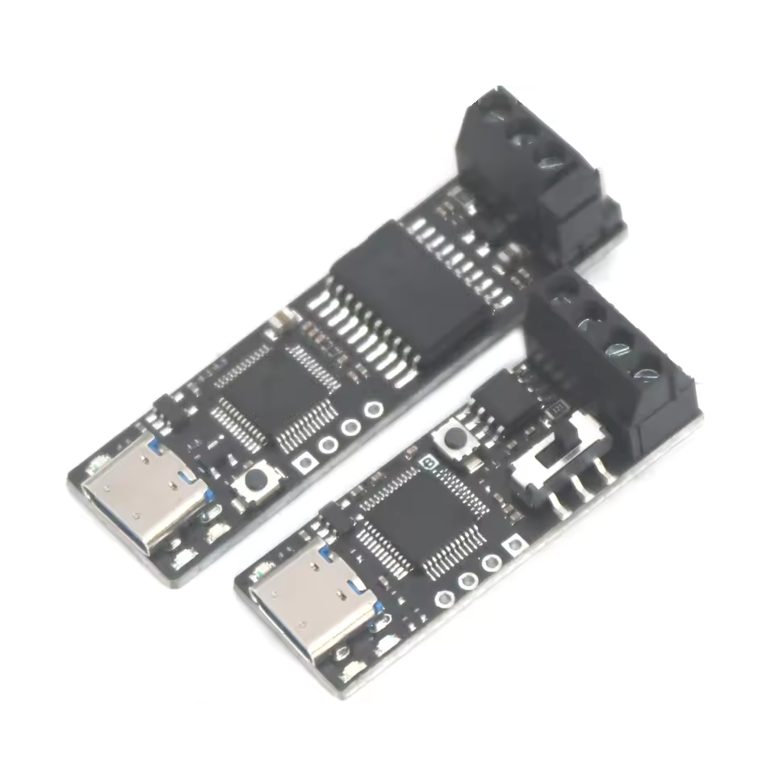

# XCAN firmware for the DykbRadio CANable V1.0

[](https://github.com/FireDeveloper/XCAN-CANable/actions/workflows/firmware_build.yml?query=branch%3Adevelop)

USB-to-CAN firmware for the DykbRadio "CANable V1.0" (STM32F072C8T6). It implements the CAN-USB protocol, so the board runs with the Windows CAN Driver and the Linux CAN Driver for that adapter family. It started as a fork of [moonglow/pcan_cantact](https://github.com/moonglow/pcan_cantact) and is now built around this one board: interrupt-driven CAN, transmission at the full bus rate, flow control in both directions, and complete bus state and error reporting.

## Highlights

- Sends and receives at the full CAN bus rate, up to 1 Mbit/s (see [Performance](#performance)).
- Bit timing exactly as the host sets it: bitrate, sample point and jump width (every 1 Mbit/s setting checked, see [Bit timing](#bit-timing)).
- Frames leave in the order the host queued them, while every transmit mailbox of the CAN controller stays busy.
- Transmit echo (self-reception) once the frame was acknowledged on the bus, stamped with the completion time.
- Bus state reporting: error active, warning, error passive and bus-off, with the receive and transmit error counters.
- Error frames: every bus error reaches the host with its type (bit, form, stuff, ACK, CRC), direction and frame segment.
- Bus-off holds until the host restarts the channel; the controller never rejoins the bus on its own.
- Single-shot transmission, listen-only mode and 42.67 µs timestamps.
- When USB falls behind, frames wait in a receive buffer and transmission with echo slows down to match, so echoes are not dropped.
- Serial number derived from the chip's unique ID; LED identify on request.
- USB vendor and product IDs at a fixed place in the image: set your own in a downloaded `.bin` or `.hex` with `utilities/usb_id.py`, no rebuild needed.

## Hardware



| Item | Value |
|---|---|
| Board | DykbRadio "CANable V1.0" |
| MCU | STM32F072C8T6, Cortex-M0 at 48 MHz, 64 KB flash, 16 KB RAM |
| Clock | Internal 48 MHz oscillator, trimmed from the USB start-of-frame packets by the clock recovery system (no crystal) |
| CAN | bxCAN, RX on PB8 and TX on PB9 (AF4) |
| TX LED | PA0, lit when high |
| RX LED | PA1, lit when high |
| USB | Full speed, device descriptor at flash address 0x08000100 (see [USB IDs](#usb-ids)) |

| Situation | TX LED | RX LED |
|---|---|---|
| Powered, no host driver yet | slow blink | slow blink |
| Driver loaded, channel closed | on | on |
| Channel open | off, flashes for each sent frame | off, flashes for each received frame |
| Identify request from the host | fast blink | fast blink |

## Performance

Measured on the board at 1 Mbit/s (BTR0/BTR1 00h/14h) with the Windows CAN Driver, against a second adapter on the same bus, 20,000 frames per run, echo enabled on the board. Rates are frames per second over the whole run.

| Test | Frames | Rate | Result |
|---|---|---|---|
| Board sends | 8 data bytes, 11-bit ID | 8,490/s | All delivered in order, 20,000 echoes in order |
| Board sends | no data, 11-bit ID | 17,650/s | All delivered, 20,000 echoes |
| Board sends | no data, 29-bit ID | 14,170/s | All delivered in order, 20,000 echoes in order |
| Board receives | 8 data bytes, 11-bit ID | 8,000/s, the sender's limit | None lost |
| Board receives | no data, 11-bit ID | 17,700/s | None lost |
| Board receives | no data, 29-bit ID | 12,250/s, the sender's limit | None lost |
| Both directions at once | no data, 11-bit ID | bus shared | All 20,000 received and 20,000 echoes, no overrun |

An 8-byte frame with an 11-bit ID takes at least 111 bit times including the interframe space, before stuff bits, so 1 Mbit/s carries at most about 9,000 of them per second; the 8,490/s above is that limit once the stuff bits of the test data are counted.

When the host floods the bus, the board sends back to back. Nodes whose frames have lower priority then get the bus only once the board's queue runs empty, which is ordinary CAN arbitration.

| Error frames | Rate | Decoded as |
|---|---|---|
| Board sends at 500 kbit/s and no node acknowledges | 3,580/s | other (ACK), transmit, ACK slot |
| Another node sends at 250 kbit/s into a 500 kbit/s bus | 11,200/s | stuff and form errors, receive |

### Resources

| Resource | Size |
|---|---|
| Flash | 16,868 bytes of 65,536 (26%) |
| RAM, static | 10,312 bytes of 16,384 |
| Stack reserve | 2,048 bytes |
| Transmit queue | 100 frames |
| Receive buffer | 128 frames or echoes |
| USB record buffer | 896 bytes, 14 USB packets |

## CAN behavior

### Bit timing

The host sends SJA1000 bit timing (BTR0/BTR1) for an 8 MHz clock, and the firmware applies it as given on the 48 MHz CAN clock: prescaler, both time segments and the resynchronization jump width. The bitrate and the sample point are the ones the host picks, up to 1 Mbit/s. A timing whose first segment is a single time quantum runs with half-length quanta instead, keeping the bitrate, sample point and jump width, because bxCAN went bus-off with such timings on this board. bxCAN samples each bit once, so a triple-sampling setting (sample count 3) runs with single sampling.

Every 1 Mbit/s setting a host tool offers for an 8 MHz clock was checked on the board: the controller's timing register read back as expected, and 200 frames went each way against a second adapter set to 00h/14h.

| BTR0 | BTR1 | Time quantum | Sample point | SJW | Result |
|---|---|---|---|---|---|
| 00h | 05h | 125 ns | 87.5% | 1 | OK |
| 00h | 14h | 125 ns | 75% | 1 | OK |
| 00h | 23h | 125 ns | 62.5% | 1 | OK |
| 00h | 32h | 125 ns | 50% | 1 | OK |
| 01h | 01h | 250 ns | 75% | 1 | OK |
| 01h | 10h | 250 ns | 50% | 1 | OK, runs with 125 ns quanta |
| 40h | 14h | 125 ns | 75% | 2 | OK |
| 40h | 23h | 125 ns | 62.5% | 2 | OK |
| 40h | 32h | 125 ns | 50% | 2 | OK |
| 41h | 10h | 250 ns | 50% | 2 | OK, runs with 125 ns quanta |
| 80h | 23h | 125 ns | 62.5% | 3 | OK |
| 80h | 32h | 125 ns | 50% | 3 | OK |
| C0h | 32h | 125 ns | 50% | 4 | OK |

Sample count 3 (BTR1 94h) also works, with single sampling.

### Bus states

| Controller state | Error counters | Windows CAN Driver shows |
|---|---|---|
| Error active | both below 96 | OK |
| Warning | one at 96 or above | bus heavy |
| Error passive | one above 127 | bus heavy |
| Bus-off | transmit counter above 255 | bus off |

Only changes are reported, the way the original adapter reports its CAN controller's status interrupts. The controller keeps its error counters across a bus off/on, so a warning or passive state left from the previous session is reported as soon as the channel opens. With error reporting enabled, each change also carries both error counters; the Linux CAN Driver tells warning from error passive by them.

### Bus-off

The controller stays bus-off until the host restarts the channel (bus off then on). The restart runs the CAN bus-off recovery, 128 occurrences of 11 recessive bits, and the end of the recovery is reported as a state change.

### Error frames

When the host enables error reporting, every bus error is sent as an error frame with its type (bit, form, stuff or other), direction (transmit or receive), the frame segment where it is known (ACK slot for ACK errors, CRC sequence for CRC errors) and both error counters. Errors that pile up between two main-loop passes share one report.

### Echo

A frame sent with echo comes back to the host once the controller reports it acknowledged on the bus, stamped with the completion time. Echoes keep the order of the frames. A frame that never reached the bus is not echoed: one aborted at bus off, or a single-shot frame whose attempt failed.

### Single-shot and listen-only

A frame marked single-shot gets one attempt and is neither retransmitted nor echoed when it fails (the Linux CAN Driver's one-shot mode). Listen-only mode receives without acknowledging or transmitting; switching it while frames wait keeps them queued, and they go out once the mode is back to normal.

### Timestamps

Frames are stamped in the CAN interrupt with a 16-bit timer that ticks every 42.67 µs. The host extends it to its own clock through a time sync record sent once a second.

### Identity

The serial number is the XOR of the 32-bit words of the STM32's 96-bit unique ID, so it differs between boards. The device number set by the host is kept until power-off.

## How it works

### Data path

- The CAN interrupt does the time-critical work: it empties the controller's 3-frame receive FIFO into a 128-entry ring and stamps each frame, retires finished transmit mailboxes in the order they were loaded, queues their echoes, and refills free mailboxes from the 100-frame transmit queue.
- The main loop polls USB, packs received frames, echoes and status into 64-byte USB packets, and decodes the host's frames into the transmit queue.
- The controller sends its mailboxes in load order (transmit FIFO priority), so the host's order holds with several mailboxes in flight.

### Flow control

- The USB data endpoint pauses while the transmit queue has fewer than 20 free slots, the most frames one USB packet can carry, so the host's own queue fills instead of frames being dropped.
- When USB is still busy with the previous transfer, received frames stay in the ring until there is room.
- Echoes travel through the same ring, so a frame that asks for an echo waits while the ring is half full; the other half stays free for frames from other nodes.

### Source files

| File | Role |
|---|---|
| `src/Src/main.c` | Clock setup and the main loop |
| `src/Src/pcan_can.c` | CAN controller: interrupt, receive ring, transmit queue and mailboxes, bus state, error events |
| `src/Src/pcan_protocol.c` | Protocol: host commands, USB record packing, bus state and error reports, timestamps in records |
| `src/Src/pcan_usb.c` | USB device class: endpoints, data flow control, vendor requests |
| `src/Src/pcan_led.c` | LED modes and blinking |
| `src/Src/pcan_timestamp.c` | 42.67 µs timer and millisecond time |
| `src/Src/pcan_varian.h` | Board pins |
| `src/Src/usbd_desc.c` | USB device descriptor and strings |
| `src/Makefile` | Build: sources, compiler flags, output in `src/build/` |
| `src/STM32F072C8Tx_FLASH.ld` | Memory layout, including the fixed address of the USB device descriptor |
| `utilities/usb_id.py` | Shows or sets the USB IDs in a built image |

## Build

Needs the GNU Arm Embedded Toolchain (`arm-none-eabi-gcc`) and GNU make. The Makefile lives in `src/`; from the repository root:

```
make -C src
```

The firmware lands in `src/build/pcan_canable.elf`, `.hex` and `.bin`. `make -C src OPT=-Og DEBUG=1` builds a debug image.

Every push and pull request to `master` and `develop` is built by GitHub Actions. The run checks that the USB device descriptor sits at its fixed address, then attaches the `.elf`, `.hex`, `.bin` and `utilities/usb_id.py` as the `pcan_canable` artifact.

Pushing a version tag on a `master` commit also publishes a GitHub Release, with the firmware as `xcan-canable-<tag>.bin`, `.hex` and `.elf` plus `usb_id.py`. A version tag on any other commit fails the release job instead of publishing.

```
git tag v1.0.0 master
git push origin v1.0.0
```

## USB IDs

The firmware keeps its USB device descriptor at a fixed flash address, 0x08000100, so the vendor and product IDs sit at the same place in every build:

| Field | Flash address | Offset in the `.bin` |
|---|---|---|
| Vendor ID (idVendor) | 0x08000108 | 0x108 |
| Product ID (idProduct) | 0x0800010A | 0x10A |

Both are 16-bit little-endian. A build carries the default IDs, 0x0483 and 0x000C. Set the IDs your host driver expects in the image itself, without a rebuild:

```
python utilities/usb_id.py pcan_canable.bin                            # show the IDs
python utilities/usb_id.py pcan_canable.hex --vid 0x1234 --pid 0x5678  # set them in the image
python utilities/usb_id.py pcan_canable.bin --pid 0x5678 -o board.bin  # write a patched copy
```

The tool needs Python 3 and nothing else. It handles `.bin` and `.hex`, rewriting only the `.hex` records it changes with fresh checksums, and it refuses an image without a device descriptor at 0x08000100. Flash the patched image as below.

## Flash

### SWD

With an ST-Link on the board's SWD pads and STM32CubeProgrammer:

```
STM32_Programmer_CLI -c port=SWD mode=UR -w src/build/pcan_canable.bin 0x08000000 -v -rst
```

### USB DFU

The STM32F072 has a USB DFU bootloader in system memory. Hold BOOT0 (pin 44) high while plugging in USB, then:

```
STM32_Programmer_CLI -c port=usb1 -w src/build/pcan_canable.bin 0x08000000 -v -rst
```

or with dfu-util:

```
dfu-util -a 0 -s 0x08000000:leave -D src/build/pcan_canable.bin
```

## Using it

### Windows

Applications built on the Windows CAN Driver's API see a single-channel USB CAN adapter. Enable error frames in the application to receive bus errors, and echo frames to receive transmit echoes.

### Linux

The Linux CAN Driver exposes the board as a SocketCAN interface:

```
sudo ip link set can0 type can bitrate 500000 restart-ms 100
sudo ip link set can0 up
candump -td can0
cansend can0 123#DEADBEEF
```

`restart-ms` lets the host restart the channel after a bus-off; without it, `sudo ip link set can0 type can restart` does it by hand. `one-shot on` and `berr-reporting on` enable single-shot transmission and the error counters. The measurements above were made with the Windows CAN Driver; Linux support follows the same protocol but was not measured.

## Changes from upstream

- Retargeted to the DykbRadio CANable V1.0 (STM32F072C8T6) alone; the other boards and the STM32F042 build were removed.
- Bus states: warning and error passive are reported with the error counters, only real state changes are sent, a state carried over from the last session shows at connect, and bus-off holds until the host restarts the channel.
- Error frames for every bus error, with type, direction and segment.
- Interrupt-driven receive and transmit, every transmit mailbox in use in load order, full bus rate in both directions.
- USB flow control replaces a blocking wait of up to a second per frame; receive back-pressure keeps echoes from being dropped.
- Echoes are sent when the frame completes on the bus; single-shot frames are honoured.
- Fixed record corruption (DLC 9 to 15, records on a packet boundary), frames from an old session going out after bus off/on, RTR handling, the USB control path, and IN endpoint recovery after a reset.
- Timestamp fixes: the timer prescaler applies from the start, records keep decodable 1-byte timestamps, and the time sync record opens its own packet.
- The vendored HAL's mailbox abort clears pending completion flags, so the firmware aborts with a single register write instead.
- Bit timings with a 1-quantum first segment run with half-length quanta, so every 1 Mbit/s setting a host offers works.
- Serial number from the chip's unique ID; LED identify.
- Includes USB and buffer fixes from [awto-au/pcan_cantact](https://github.com/awto-au/pcan_cantact).

## License

MIT, see [LICENSE](LICENSE). The vendored code under `src/Drivers/` and `src/Middlewares/`, and the STMicroelectronics startup, system and linker files, keep their own licenses.
